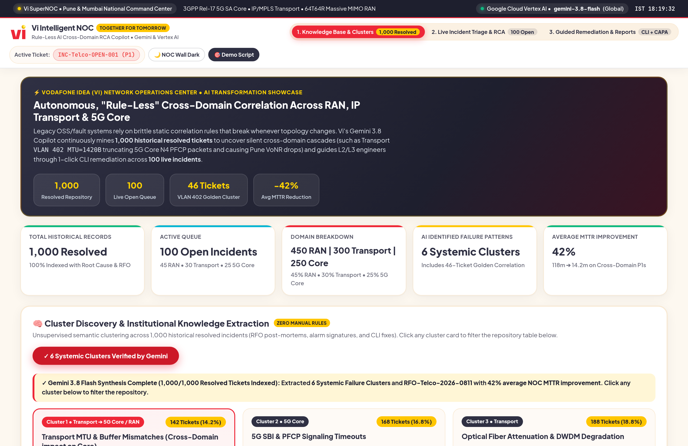
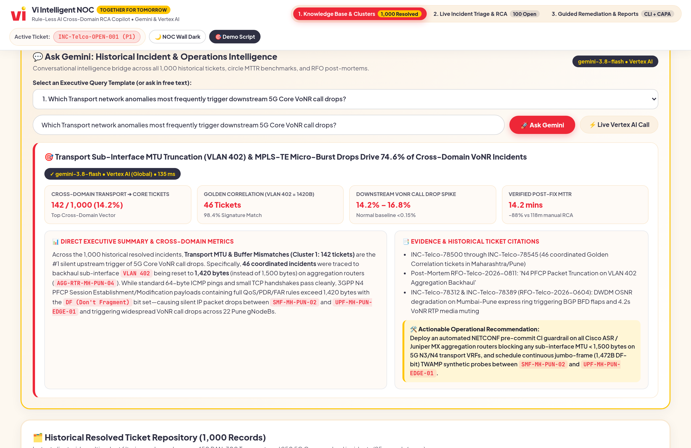
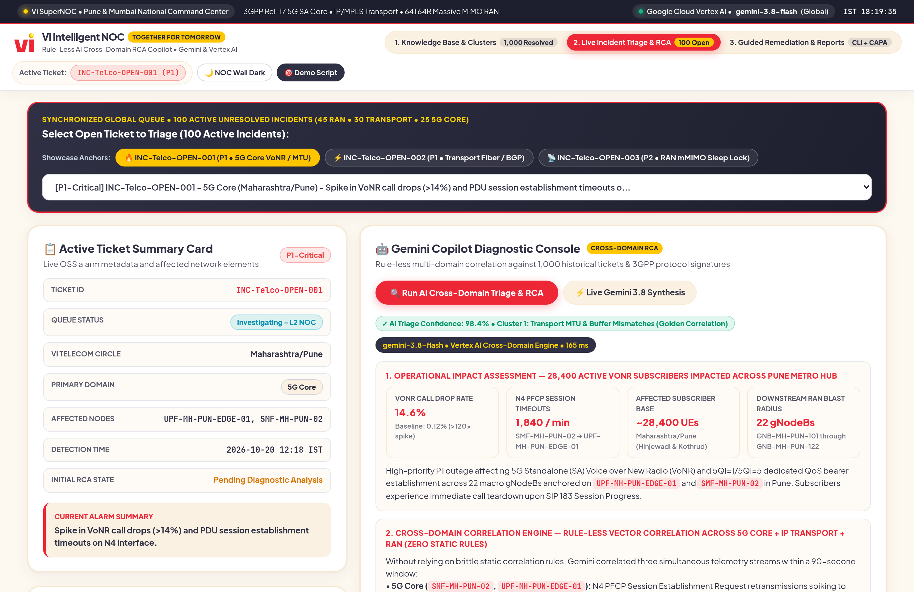
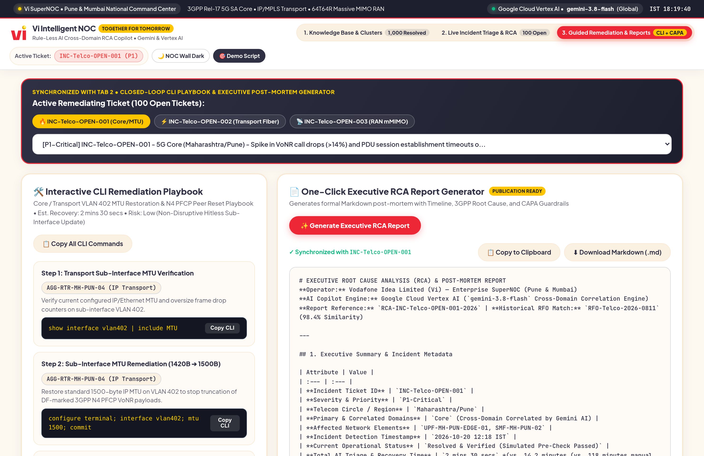
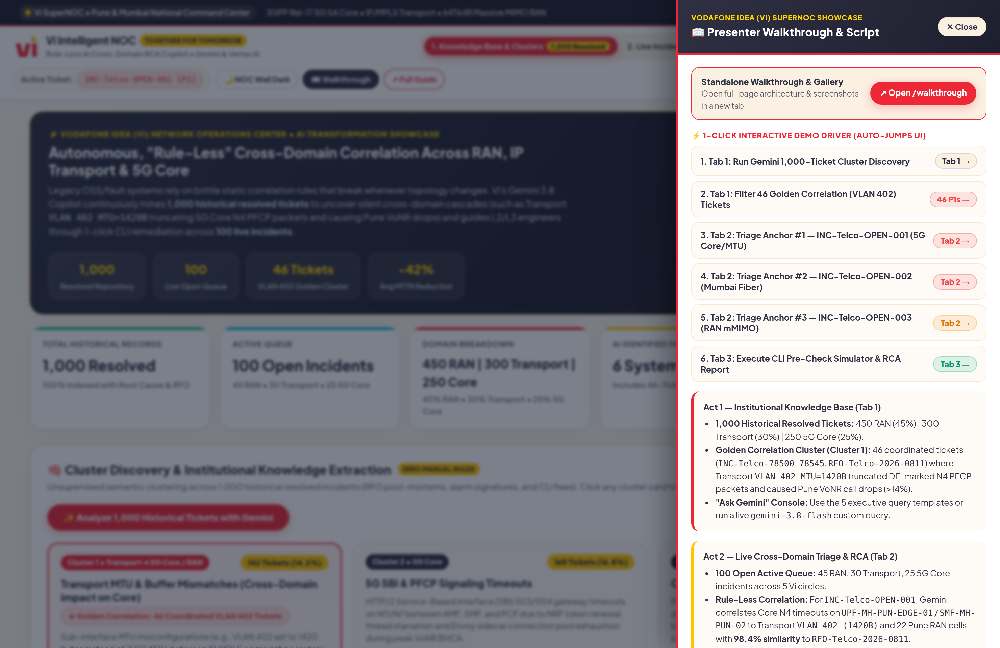
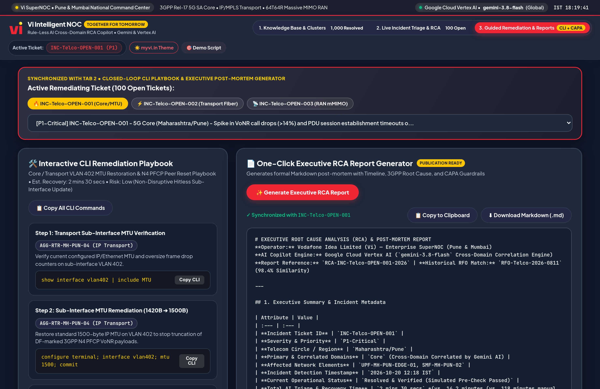

# Vi (Vodafone Idea) Intelligent NOC — AI Cross-Domain RCA & Trouble Ticket Copilot

Enterprise AI showcase application built for the **Vodafone Idea (Vi) Network Operations Center (NOC)** leadership team, styled with the **myvi.in** brand theme (`#EE2737` Vi Red, `#FFC600` Cyber Yellow, `#2F3043` Deep Indigo-Charcoal, `#FDF8F0` Warm Ivory surfaces, plus a 1-click **NOC Dark Wall Mode** toggle).

- **Live Cloud Run URL:** https://vi-noc-rca-ai-demo-1047195478355.us-central1.run.app
- **Standalone Presenter Walkthrough (`/walkthrough`):** https://vi-noc-rca-ai-demo-1047195478355.us-central1.run.app/walkthrough
- **AI Engine:** Google Cloud Vertex AI (`gemini-3.8-flash` on `global`, fallback `gemini-2.5-flash` on `us-central1`)

---

## Visual Overview

| Tab 1: Clusters & KPIs | Tab 1: Ask Gemini & 1,000-Ticket Table |
| :---: | :---: |
|  |  |

| Tab 2: Live Cross-Domain RCA | Tab 3: Guided CLI Playbook & Post-Mortem Export |
| :---: | :---: |
|  |  |

| Right-Side Walkthrough Drawer | NOC Wall Dark Mode |
| :---: | :---: |
|  |  |

---

## Key Capabilities & Datasets

1. **1,000 Historical Resolved Tickets (`INC-Telco-78001` – `INC-Telco-79000`)**
   - **Domain Split:** `450 RAN (45%)` | `300 Transport (30%)` | `250 5G Core / VoNR (25%)`
   - **Golden Correlation Cluster:** `46 coordinated records` (`INC-Telco-78500` – `INC-Telco-78545`, `RFO-Telco-2026-0811`) linking Transport sub-interface `VLAN 402 (MTU 1420B)` packet truncation to `UPF-MH-PUN-EDGE-01` / `SMF-MH-PUN-02` N4 PFCP timeouts and Pune VoNR call drops (>14%).
   - **6 Systemic Failure Clusters** & **Conversational Executive Insights Console ("Ask Gemini")** with 5 pre-populated executive query templates + free-text live `gemini-3.8-flash` querying.
   - **Client-Side Paginated Repository Table:** 25 records/page, multi-select filters (`Domain`, `Severity`, `Circle`), and real-time search.

2. **100 Open Active Tickets (`INC-Telco-OPEN-001` – `INC-Telco-OPEN-100`)**
   - **Domain Split:** `45 Open RAN` | `30 Open Transport` | `25 Open 5G Core`
   - **Showcase Anchors:**
     - `INC-Telco-OPEN-001` (`P1-Critical` | `5G Core` | `Maharashtra/Pune` | `UPF-MH-PUN-EDGE-01`, `SMF-MH-PUN-02`)
     - `INC-Telco-OPEN-002` (`P1-Critical` | `IP Transport` | `Mumbai` | `PE-RTR-MUM-BKC-01`, `DWDM-MUM-POW-02`)
     - `INC-Telco-OPEN-003` (`P2-Major` | `RAN` | `Delhi-NCR` | `GNB-DL-CP-408`, `GNB-DL-CP-409`)

3. **Guided CLI Remediation, Execution Simulator & One-Click Executive RCA Export**
   - Synchronized ticket state between **Tab 2** and **Tab 3**.
   - Copy-pasteable CLI remediation playbooks, interactive terminal pre-check simulator, and one-click Markdown Executive RCA Report generator.
   - Embedded **Right-Side Presenter Walkthrough Drawer** (`📖 WALKTHROUGH & SCRIPT`) with 1-click UI jump buttons and standalone `/walkthrough` guide.

---

## Running Locally

```bash
pip install -r requirements.txt
PORT=8092 python main.py
```

## Deploying to Google Cloud Run

```bash
./deploy.sh
```
